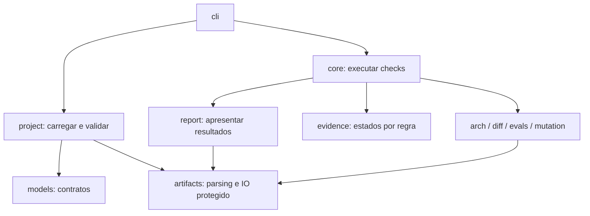

# Arquitetura interna e garantias

O kit separa quatro responsabilidades que antes se concentravam em `core.py`.

| Módulo | Interface e responsabilidade | Efeitos |
|---|---|---|
| `models` | Schema e validação lexical de contratos | Nenhuma execução ou IO |
| `project` | `load(root)` retorna declarações e diagnósticos | Leitura de YAML e datasets |
| `core` | `check(project)` executa e agrega verificações | Testes e gates configurados |
| `artifacts` | Parsing inequívoco, `confined` e `atomic_write` | IO protegido dentro do projeto |
| `evidence` | `architecture_verdicts(report)` interpreta resultados por regra | Nenhum efeito |
| `arch`, `diff`, `evals`, `mutation` | Verificadores especializados | Limitados ao comando escolhido |
| `review`, `workflow` | Análise estática e contexto para o agente | Sem execução de comandos |
| `report`, `cli` | Apresentação, persistência e códigos de saída | Relatórios e interação |

`core.load`, `core.Project` e `core.dataset_ids` permanecem disponíveis por
compatibilidade. O carregador não importa o executor de comandos. ARCH-004 cobra essa
direção de dependência; ARCH-005 protege a interpretação pura de evidências. Não há
um sistema de plugins ou interfaces abstratas para dependências que ainda não variam.

## Dados inválidos falham antes da execução

- YAML com chaves explícitas duplicadas é rejeitado; merge YAML com override explícito
  continua permitido. Erros de leitura e codificação recebem caminho no diagnóstico.
- Os números dos contratos devem ser finitos, incluindo `threshold`, NFRs, tetos de
  custo, variação e configuração de mutação. NaN e infinitos não são limites válidos.
- JSONL rejeita chaves duplicadas e números não finitos. `run` é inteiro positivo;
  strings, booleanos, floats e zero não identificam uma execução.
- Chamar `core.check` com um projeto inválido retorna reprovação sem executar testes.

## Persistência e limpeza

Saídas devem ser caminhos relativos ao projeto. Caminhos absolutos, traversal (`..`),
drives Windows e componentes simbólicos são recusados. JSON e Markdown usam arquivos
temporários regulares e substituição atômica **por arquivo**; não há transação conjunta
entre os dois relatórios. A serialização JSON não permite NaN ou infinito.

No POSIX, o escritor percorre diretórios com descritores e `O_NOFOLLOW`, e substitui
o destino em relação ao diretório aberto. No Windows, valida os componentes, a
resolução dentro da raiz e usa substituição atômica do arquivo. Essas proteções
impedem seguir links já fornecidos pelo checkout; não constituem um sandbox contra
processos hostis com a mesma autoridade do operador.

Evals limpam somente os arquivos `<EVAL-ID>.jsonl` declarados para aquela chamada.
Não removem recursivamente a pasta configurada. Diretórios que contêm fontes, specs
ou datasets, ou que ficam dentro de `src`, `specs` ou `.git`, são recusados antes do
harness. Arquivos vizinhos não são apagados.

Mutação verifica se cada alvo resolvido permanece dentro da cópia, antes de executar
a suíte e antes de escrever/restaurar candidatos. Links absolutos para o checkout ou
dependências compartilhadas não podem receber mutações. Links relativos internos
podem ser preservados. Comandos de teste continuam tendo a autoridade do operador.

## Arquitetura verificável

Python é analisado com AST, incluindo imports multilinha, `from . import modulo` e
imports absolutos que correspondem aos módulos locais da raiz ou do layout `src/`.
O parser não executa código. Falhas de leitura, codificação e sintaxe reprovam a regra.
JS/TS e Go mantêm leitura textual e os limites documentados.

O relatório contém `rule_results`. CLI, check, constituição e riscos usam a mesma
interpretação: uma regra reprovada não altera o estado de outra regra que foi
executada e aprovada. Relatórios antigos sem essa matriz ainda são interpretáveis.

## Distribuição

`tests/test_distribution.py` constrói um wheel e o instala fora do checkout, exercitando
CLI, catálogo empacotado, inicialização, análise e guia. As dependências são as do
ambiente de teste; o subprocesso verifica que `sdd` veio do diretório instalado.

O workflow de release exige tag `v<versão>` correspondente ao pacote, valida as specs,
executa o check, constrói e testa a distribuição antes da publicação. A publicação
permanece em job separado, com OIDC e ambiente `pypi`. Proteção de tags, aprovações de
ambiente e registro do trusted publisher dependem da configuração no GitHub/PyPI.

## Critérios de qualidade

O objetivo é reduzir aprovações indevidas, preservar arquivos e manter mudanças
rastreáveis. Número de testes, mutação amostrada e funcionamento dos pacotes são
evidências com alcance próprio. Não estabelecem superioridade sobre todos os projetos
do GitHub nem provam a qualidade semântica de testes, planos ou datasets.
